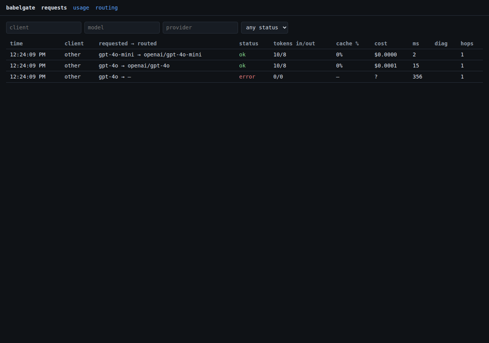

# babelgate

**The translator you can check.** A small proxy that sits in front of
LLM APIs and translates between their request/response formats —
streaming, tool calls, reasoning and media included. Point your
OpenAI client at it, and it can talk to Gemini, Ollama, or Anthropic behind
the scenes — and vice versa. Point Claude Code or Codex CLI at it, and it
runs on any tool-capable model you can reach.

## Install

| OS | Command |
|---|---|
| macOS / Linux (Homebrew) | `brew install dorrabbkhan/babelgate/babelgate` |
| macOS / Linux (script) | `curl -fsSL https://raw.githubusercontent.com/dorrabbkhan/babelgate/main/install/install.sh \| sh` — installs to `~/.local/bin` |
| Windows (PowerShell) | `irm https://raw.githubusercontent.com/dorrabbkhan/babelgate/main/install/install.ps1 \| iex` — installs to `%LOCALAPPDATA%\babelgate\bin` |
| Any OS (Node ≥ 22.13) | `npx babelgate` or `npm install -g babelgate` |
| Docker | `docker run -p 3000:3000 ghcr.io/dorrabbkhan/babelgate:latest` |

The install scripts download the release binary, check it against the
release's `SHA256SUMS` and verify its cosign signature when cosign is on
PATH — a mismatch aborts and leaves nothing behind
([install/](install/)). A winget manifest is prepared under
[packaging/winget/](packaging/winget/) and pending submission. Every
install path runs the same `babelgate` CLI — `babelgate --help` prints
the flags; [docs/reference.md](docs/reference.md) documents them all.

## Free first run: Claude Code or Codex on a free model

One command — `--provider` fills the target, base URL, key env var and
a model that was proven on the edit-task gate before it was listed:

```bash
GEMINI_API_KEY=<free key from https://aistudio.google.com/apikey> \
  babelgate --preset claude-code --provider gemini-free
```

It prints the two lines Claude Code needs:

```
export ANTHROPIC_BASE_URL=http://localhost:3000
export ANTHROPIC_AUTH_TOKEN=babelgate
```

Paste them, then run `claude`. For Codex, the same command with
`--preset codex` prints `export BABELGATE_KEY=…`, writes the model
catalog Codex needs under `~/.babelgate`, and prints the
`~/.codex/config.toml` block to paste — walkthrough:
[docs/recipes/codex.md](docs/recipes/codex.md).

`gemini-free` is one of five free-tier presets; `openrouter-free`,
`groq`, `nvidia-nim` and `cerebras` are the others and `deepseek` is
the cheap one — `babelgate presets` lists each with the provider doc it
was verified against and the verification date ("free" always means
*per the provider's own docs on that date*, never a promised limit;
[src/config/provider-presets.ts](src/config/provider-presets.ts)).
Presets with no proven suggestion ship with no client model — pass
`--model` yourself for those.


*Recorded with [scripts/demo](scripts/demo/) on the release binary; the model's thinking time is cut.*


*Recorded with [scripts/demo](scripts/demo/) on the release binary; the model's thinking time is cut.*

## The "check" is the product

- **A published compatibility matrix** — every source × target ×
  feature cell, generated from the pair tests; CI regenerates it and
  fails on drift: [docs/compatibility.md](docs/compatibility.md).
- **A weekly client replay** — a scheduled job installs the newest
  Claude Code and Codex releases and replays their recorded shapes
  through the release gates; a drift opens an issue:
  
- **Signed releases** — the release binaries and the container image
  are cosign-signed in CI, each release carries `SHA256SUMS` and a
  CycloneDX SBOM, and the install scripts verify both before anything
  is installed: [SECURITY.md](SECURITY.md).
- **The shipped binary is the tested binary** — a process-level suite
  (`npm run test:process`) runs the binary itself against a local mock
  upstream, on each release platform.
- **The translation inspector** — source, canonical and target side by
  side, every dropped field named, failed requests included (`/ui`,
  below).
- **Small and auditable** — few runtime dependencies, provider SDKs kept
  as type-only devDependencies: [SECURITY.md](SECURITY.md).

## Clients

One running babelgate serves every client dialect at once — OpenAI
(`/v1/chat/completions`, `/v1/responses`), Anthropic (`/v1/messages`),
Gemini (`/v1beta/models/…`), Ollama (`/api/chat`):

- **Coding agents:** [Claude Code](docs/recipes/claude-code.md) (incl.
  a [hybrid local + hosted routing setup](docs/recipes/claude-code-hybrid.md)),
  [Codex CLI](docs/recipes/codex.md),
  [Antigravity CLI](docs/recipes/antigravity-cli.md),
  [Cursor](docs/recipes/cursor.md) (setup documented, not verified end
  to end), [Continue](docs/recipes/continue.md),
  [Aider](docs/recipes/aider.md), [Open WebUI](docs/recipes/open-webui.md),
  [Gemini CLI](docs/recipes/gemini-cli.md) (frozen — Google moved
  individual users to Antigravity).
- **SDKs and apps:** [OpenAI SDK](docs/recipes/openai-sdk.md),
  [LangChain](docs/recipes/langchain.md),
  [LlamaIndex](docs/recipes/llamaindex.md),
  [Vercel AI SDK](docs/recipes/vercel-ai-sdk.md),
  [Ollama-only apps on cloud models](docs/recipes/ollama-apps.md) —
  each SDK recipe has a CI-checked example under `examples/sdk/`.
- **OpenAI-compatible backends** (Groq, DeepSeek, Together, LM Studio,
  vLLM, llama.cpp…): a `type: openai` provider —
  [docs/recipes/openai-compatible-providers.md](docs/recipes/openai-compatible-providers.md).
- **Anthropic-speaking endpoints** (Ollama, LM Studio, DeepSeek, z.ai,
  Kimi): the native-endpoint shim passes requests through and fixes
  each endpoint's declared gaps —
  [docs/recipes/native-endpoints.md](docs/recipes/native-endpoints.md).

## How it works

Every request goes through a **canonical format** in the middle — one
adapter per provider, never one transformer per provider pair:

```
OpenAI request ──► canonical ──► Gemini request
Gemini response ──► canonical ──► OpenAI response
```

The path decides the client's dialect (`/v1/chat/completions` is
OpenAI, `/v1/messages` Anthropic, `/v1beta/models` Gemini, `/api/chat`
Ollama, `/v1/responses` Responses); the body decodes to canonical,
routes to a provider (config file, or the single `TARGET_API` in
env-only mode), encodes in the target's format, forwards upstream, and
the response comes back through the same path in reverse — streaming,
tools, reasoning and media included. Endpoint kinds, error shapes and
auth: [docs/reference.md](docs/reference.md); internals:
[docs/architecture.md](docs/architecture.md).

With a `babelgate.yaml`, the same port serves **every client format at
once** and routes by model name, with aliases, a long-context
condition, and fallbacks before the first byte:

```yaml
routes:
  - match: claude-*haiku*
    to: ollama/qwen2.5-coder:7b
  - match: claude-*
    when:
      min_input_tokens: 60000
    to: openrouter/qwen/qwen3-coder
  - match: claude-*
    to: ollama/qwen3-coder:30b
    fallback:
      - openrouter/qwen/qwen3-coder
```

([examples/claude-code-hybrid.yaml](examples/claude-code-hybrid.yaml) —
the npm package doesn't ship `examples/`; fetch the file first, saving
it as `babelgate.yaml` also works.) Each provider also gets a passive
in-memory **circuit breaker** (open after 3 consecutive upstream
failures, 30 s cool-down doubling to 5 min — it skips the provider
during route planning but never refuses a request outright), and an
opt-in exact-match **response cache** for CI runs (`cache:` or
`CACHE=on`). Tuning and the full env-var table:
[docs/reference.md](docs/reference.md).

## See what's happening

Every chat request produces a **request trace** — client, routed
provider/model, hops and fallbacks, tokens, cache hits, cost, timings —
fanned out to isolated sinks: the log line, a SQLite usage store
(`USAGE_DB`, default `~/.babelgate/usage.db`), an in-memory body ring,
Prometheus metrics, and optional OpenTelemetry spans. Open
`http://localhost:3000/ui` for the built-in UI: a live Requests feed
(failed requests included), a per-request Inspector that diffs each
translation stage, Usage (cost and tokens per day/model/client, "saved
≈ $X" for local rows), the Routing table with live breaker state, and a
Playground that streams up to four models side by side.



Bodies stay private: prompts, completions and tool arguments reach only
the in-memory ring (last `INSPECTOR_BUFFER` requests) — and disk only
with `LOG_BODIES=true`. Metrics carry labels, never content. The whole
privacy model, every `observe:` setting, `/metrics` scrape config, OTel
and Docker notes:
[docs/recipes/observability.md](docs/recipes/observability.md).

## How is this different?

Putting Claude Code or Codex on another model is table stakes — several
tools do it. babelgate is the one whose translations you can verify: the
generated matrix, the per-request inspector, the declared-gap shim, and
signed releases. The honest trade-offs — provider count, MCP gateway,
semantic cache, load balancing, team governance, a hosted option — all
belong to the others, and the full dated matrix says "use X if you need
that": [docs/comparison.md](docs/comparison.md).

## Known limitations

- **Claude Code ↔ Ollama has not been gate-tested on a capable model.**
  The release gate passed on hosted models (OpenRouter
  `qwen/qwen3-coder`, `poolside/laguna-s-2.1:free`; the v1.6 preset
  suggestions each passed the same edit task live — see the comments in
  [src/config/provider-presets.ts](src/config/provider-presets.ts)), proving
  Claude Code end to end through babelgate; the Ollama adapter is
  live-tested nightly, but the combined path on `qwen3-coder:30b` was
  never run. Local models may call tools unreliably, and on CPU-only
  machines a slow model can stall past `UPSTREAM_STREAM_IDLE_MS`
  (default 300 s) and have its stream cut.
- **Reasoning stays bound to its origin.** All five client formats
  carry the model's reasoning: request fields (`thinking`,
  `reasoning_effort`, `thinkingConfig`, `think`, `reasoning`) map to the
  target's thinking control, and signed thinking
  (`signature`/`thoughtSignature`, packed in `bg1.` envelopes) returns
  between turns of the same provider/model. Reasoning from provider X
  is never sent to provider Y — it's dropped with a `reasoning_dropped`
  note, and an Anthropic target that can't present a foreign block gets
  thinking disabled for that request. `reasoning: false` on a provider
  restores the v1.4 drop behaviour for it. `cache_control`/`metadata`
  on non-shim paths are still dropped (debug-logged by type name only).
- **Media is refused, never silently dropped.** Documents go only to
  targets that read them — elsewhere the request fails with a 400 in the
  client's dialect naming the field (text documents become text parts
  instead). Images inside tool results are refused on Chat and Ollama
  targets, which can't carry them.
- **`parallel_tool_calls` is honoured only from Responses clients** —
  decoded on `/v1/responses` and mapped to OpenAI, Anthropic and Responses
  targets; the other sources can't express it and providers get their own
  default parallel behaviour.
- **Not every pair is equally verified.** Streaming and tools are
  implemented in all five adapters and the full 5×5 pair matrix runs in CI,
  but the streaming × tools release gates cover only a few launch pairs
  (`anthropic → ollama`, `anthropic → openai` — which is how OpenRouter is
  reached — `openai → ollama`, plus the v1.4 Codex gates).
- **`count_tokens` is an estimate** (chars/4), marked by the
  `x-babelgate-token-estimate: true` header — enough for Claude Code's
  budgeting, not for billing.
- **Non-chat Gemini methods return 501** — `:countTokens`, `:embedContent`
  and friends aren't translated.
- Some provider-specific features (citations, extra usage fields) map to
  canonical best-effort — the format only keeps what's expressible
  across providers.
- **No config hot reload and no overall request deadline** — a
  `babelgate.yaml` change needs a restart, and worst-case latency is the
  sum of per-attempt timeouts across a fallback chain.

## Roadmap

Shipped so far: the 16-pair matrix (v1.1), one endpoint for many
providers (v1.2), observability and the `/ui` (v1.3), the Responses
API / Codex entry point (v1.4), "correct everywhere" (v1.5 — reasoning
and media for every client format, the native-endpoint shim, the
generated compatibility matrix with client-release replay, signed
releases, minimal embeddings), and "one command, free to start"
(v1.6 — single-file binaries and installers, free provider presets
with `--provider`, the `codex` client preset, a passive circuit
breaker, an opt-in response cache and `between_tools` thinking).
Release notes are in [CHANGELOG.md](CHANGELOG.md); the
version-by-version plan lives in
[docs/roadmap.md](docs/roadmap.md).

## License

Apache-2.0 — see [LICENSE](LICENSE) and [NOTICE](NOTICE). Contributions
are welcome: [CONTRIBUTING.md](CONTRIBUTING.md) covers setup and checks,
and first-time contributors sign the [CLA](CLA.md) once via the CLA
Assistant bot on their first PR.
